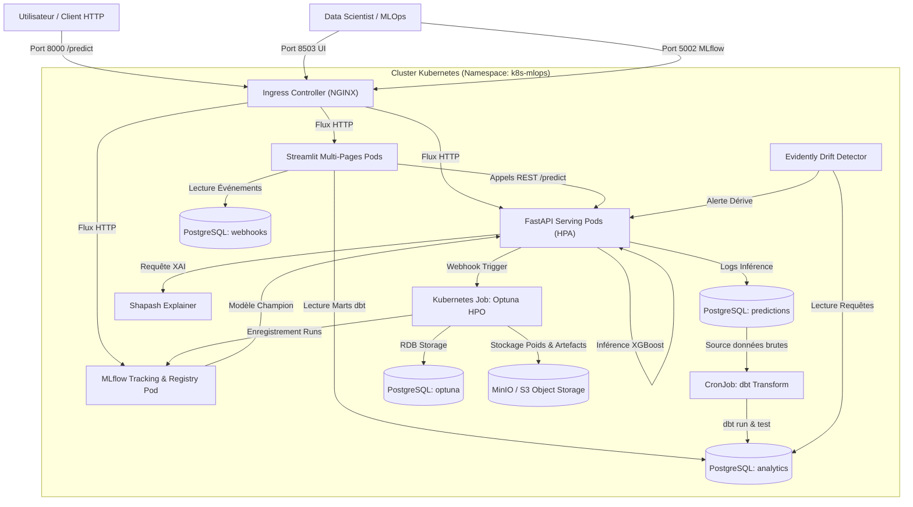
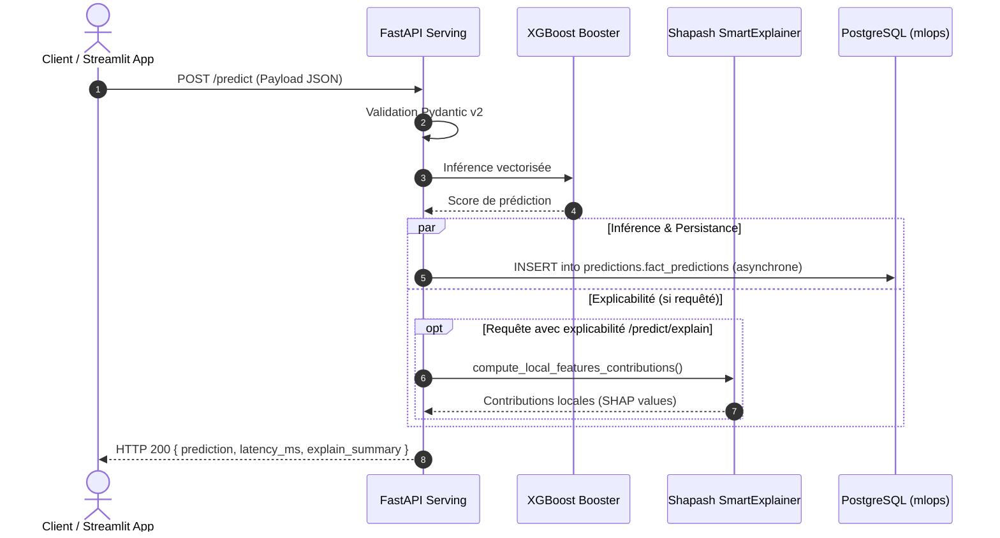
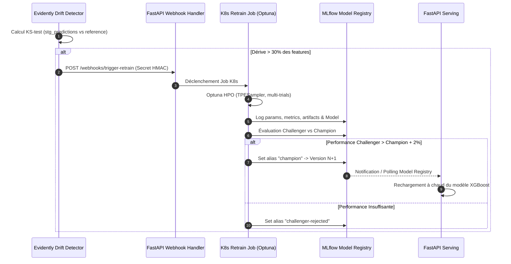

# Architecture Technique — `k8s_mlops_platform`
## Template MLOps Cloud-Native Kubernetes Générique

> **Projet** : `k8s_mlops_platform`  
> **Type de document** : Architecture Spine & Spécification Système  
> **Public cible** : Ingénieurs MLOps, Architectes Logiciels, Contributeurs Open-Source  
> **Modèle Référent** : **XGBoost**  
> **Moteur HPO** : **Optuna** (Bayésien distribué)  
> **Explicabilité** : **Shapash** (SHAP vulgarisé)  
> **Transformation & Data Build** : **dbt** (`dbt-postgres`)  
> **Base de Données** : **PostgreSQL 15+** (StatefulSet multi-bases)  
> **Serving & Webhooks** : **FastAPI** asynchrone  
> **Dashboarding** : **Streamlit 4-Pages** (`App`, `XAI`, `Analytics`, `Webhooks`)

---

## 1. Paradigme & Principes Directeurs

Le système applique les principes fondateurs du **Cloud Native Computing Foundation (CNCF)** et de la méthodologie **Twelve-Factor App** :

1. **Découplage Intégral Stockage / Calcul** : Le calcul (FastAPI, Ray/Optuna, Streamlit) est strictement stateless et horizontalement scalable. L'état réside dans PostgreSQL (StatefulSet persistant) et le stockage objet S3/MinIO.
2. **Déploiement Déclaratif Uniforme (GitOps-Ready)** : Zéro configuration impérative manuelle. L'intégralité de la plateforme s'instancie via un Chart Helm paramétrable (`values.yaml`).
3. **Observabilité & MLOps en Boucle Fermée** : Chaque prédiction servie alimente la surveillance de dérive (Evidently), laquelle déclenche le réentraînement (Optuna HPO), suivi de la promotion automatique (Champion vs Challenger dans MLflow).
4. **Gouvernance & Qualité des Données (Analytics as Code)** : Les données opérationnelles d'inférence sont modélisées et testées dans PostgreSQL via **dbt** avant d'être exposées au Dashboard.

---

## 2. Décisions Architecturales Invariantes (Architectural Decisions)

### AD-01 — Topologie Kubernetes & Isolation des Ressources [ADOPTED]
* **Binds** : L'ensemble des microservices, configurations et volumes du cluster.
* **Prevents** : Les collisions de noms, les fuites de secrets entre environnements et l'accès non contrôlé aux bases internes.
* **Rule** : Tous les composants sont déployés dans un namespace dédié configurable (par défaut `k8s-mlops`). Aucun service de stockage (PostgreSQL, MinIO) n'est exposé publiquement ; seul l'Ingress NGINX ou le port-forward local route les requêtes externes vers FastAPI (`8000`), Streamlit (`8503`) et MLflow (`5002`).

### AD-02 — Persistance Multi-Bases PostgreSQL & Modélisation dbt [ADOPTED]
* **Binds** : Le StatefulSet PostgreSQL, les schémas analytiques et le projet `dbt/`.
* **Prevents** : La saturation de la base de tracking par les requêtes d'inférence et le manque de typage/validation des données analytiques.
* **Rule** : PostgreSQL est partitionné en trois bases de données étanches :
  1. `mlops` : héberge les schémas `features` (entraînement), `predictions` (logs d'inférence FastAPI), `analytics` (marts modélisés et testés par dbt) et `webhooks` (journalisation des événements).
  2. `mlflow` : backend store exclusif de MLflow (métadonnées d'expériences et Model Registry).
  3. `optuna` : RDB Storage dédié aux études d'optimisation distribuées.  
  Un CronJob Kubernetes exécute périodiquement `dbt run && dbt test` sur la base `mlops`.

### AD-03 — Serving Asynchrone FastAPI & Découplage Inférence / Dashboard [ADOPTED]
* **Binds** : Le microservice `serving` et les interfaces externes.
* **Prevents** : Le couplage direct entre le frontend Streamlit et le modèle en mémoire, et l'effondrement du débit sous forte charge.
* **Rule** : L'inférence est exclusivement exposée par FastAPI (`POST /predict`, `POST /predict/batch`, `POST /predict/explain`). Le Dashboard Streamlit ne charge pas le modèle directement : il agit en client HTTP de FastAPI. En cas de crash ou de rechargement du frontend, l'API de production reste 100 % disponible.

### AD-04 — Modèle Tabulaire XGBoost & Format d'Artefact Ouvert [ADOPTED]
* **Binds** : Le pipeline d'entraînement, l'export de modèles et le moteur d'inférence.
* **Prevents** : Les dépendances de désérialisation non sécurisées (`pickle` opaque) et l'incompatibilité inter-langages.
* **Rule** : Le modèle de référence est sérialisé au format natif JSON/UBJ (`xgboost.Booster.save_model("model.json")`) ou via le flavor standard `mlflow.xgboost`. Les poids sont versionnés sur S3/MinIO et catalogués dans le Model Registry MLflow.
  - Structure normalisée des Buckets Object Storage :
    - `s3://bronze/` : Sauvegarde brute compressée (Parquet/JSON).
    - `s3://models/` : Scalers normalisés, poids et artefacts de tracking MLflow (`s3://models/mlflow`).
    - `s3://reports/` : Rapports HTML et JSON d'observabilité de dérive (Data & Concept Drift).

### AD-05 — Optimisation Bayésienne Distribuée Optuna [ADOPTED]
* **Binds** : Le module `src/training/hpo_optuna.py` et les workers d'entraînement.
* **Prevents** : Le blocage synchrone des nœuds d'entraînement et la perte d'historique lors d'interruptions de pods.
* **Rule** : Les études Optuna s'exécutent via `TPESampler` avec pruners (MedianPruner) connectés à `postgresql://.../optuna`. Chaque trial est automatiquement consigné comme nested run MLflow via `optuna.integration.MLflowCallback`. Le meilleur trial est automatiquement extrait pour l'évaluation Champion/Challenger.

### AD-06 — Explicabilité Native XAI via Shapash [ADOPTED]
* **Binds** : Le module `src/xai/explainer.py`, l'API `/predict/explain` et la page Streamlit `2_XAI.py`.
* **Prevents** : L'effet « boîte noire » et la dépendance à des calculs SHAP lents et non vulgarisés à l'inférence.
* **Rule** : Un objet `SmartExplainer` Shapash est entraîné conjointement avec le modèle XGBoost et sauvegardé en tant qu'artefact. Il fournit les explications globales (feature importance) et locales (waterfall contributions positives/négatives) avec libellés métier explicites.

### AD-07 — Cycle de Vie MLOps & Promotion Automatique par Alias MLflow [ADOPTED]
* **Binds** : Le serveur MLflow et le script de promotion `src/tracking/evaluate.py`.
* **Prevents** : Les régressions de performance en production et l'usage de stages dépréciés (`None/Staging/Production`).
* **Rule** : Le Challenger n'obtient l'alias `champion` que si sa métrique principale (RMSE ou F1-score) surpasse le modèle actuel d'au moins $\Delta = 2\%$. Les alias gérés sont `champion`, `challenger` et `rollback`. FastAPI interroge périodiquement le Model Registry et effectue un rechargement à chaud sans interruption.

### AD-08 — Détection de Dérive Statistique Evidently & Déclenchement de Webhooks [ADOPTED]
* **Binds** : Le job `src/monitoring/drift_detector.py` et les endpoints webhooks de FastAPI.
* **Prevents** : L'obsolescence silencieuse du modèle face aux changements de distribution des données.
* **Rule** : Le détecteur de dérive compare la table dbt `stg_predictions` aux données de référence via le test de Kolmogorov-Smirnov. Si plus de 30 % des features présentent une p-value $< 0.05$, un webhook sécurisé `POST /webhooks/trigger-retrain` est émis vers le cluster pour instancier un Job de réentraînement (avec cooldown minimal de 6h).

### AD-09 — Architecture Streamlit 4-Pages Découplée [ADOPTED]
* **Binds** : Le répertoire `src/dashboard/` et l'interface utilisateur.
* **Prevents** : Les scripts monolithiques Streamlit non maintenables et les fuites de contexte d'état de session.
* **Rule** : L'application Streamlit suit la structure native multi-pages de Streamlit :
  * `app.py` : Point d'entrée et navigation globale.
  * `pages/1_App.py` : Saisie des données et inférence en direct via FastAPI.
  * `pages/2_XAI.py` : Visualisations d'explicabilité Shapash (SmartPlotter, waterfall).
  * `pages/3_Analytics.py` : KPIs opérationnels branchés sur les tables dbt `analytics.mart_*`.
  * `pages/4_Webhooks.py` : Journal des événements et triggers manuels de réentraînement.

### AD-10 — Sécurité Conteneurs & Moindre Privilège (PSS Restricted) [ADOPTED]
* **Binds** : Tous les `Dockerfile.*` et templates de déploiement Helm.
* **Prevents** : L'exécution sous utilisateur root, les escalades de privilèges et la non-conformité aux clusters sécurisés d'entreprise.
* **Rule** : Tous les conteneurs s'exécutent avec `USER 10001` (groupe non-privilégié `mlops`), `readOnlyRootFilesystem: false` (ou répertoires temporaires montés en `emptyDir`), et `allowPrivilegeEscalation: false`.

---

## 3. Schémas d'Architecture Système (Mermaid)

### 3.1 Diagramme de Contexte & Composants (C4 Niveau 2)



### 3.2 Diagramme de Séquence : Inférence Temps Réel, XAI & Persistance



### 3.3 Diagramme de Séquence : Dérive, Réentraînement Optuna & Auto-Promotion



---

## 4. Modélisation des Données & Contrats d'Interface

### 4.1 Structure des Schémas PostgreSQL

```sql
-- Base : mlops
CREATE SCHEMA IF NOT EXISTS features;
CREATE SCHEMA IF NOT EXISTS predictions;
CREATE SCHEMA IF NOT EXISTS analytics;
CREATE SCHEMA IF NOT EXISTS webhooks;

-- Table d'ingestion brute des requêtes d'inférence
CREATE TABLE IF NOT EXISTS predictions.fact_predictions (
    id BIGSERIAL PRIMARY KEY,
    request_id UUID NOT NULL,
    received_at TIMESTAMP WITH TIME ZONE DEFAULT CURRENT_TIMESTAMP,
    features_payload JSONB NOT NULL,
    predicted_value REAL NOT NULL,
    latency_ms REAL NOT NULL,
    model_version TEXT NOT NULL
);
CREATE INDEX IF NOT EXISTS idx_pred_received_at ON predictions.fact_predictions(received_at);

-- Table des événements Webhooks
CREATE TABLE IF NOT EXISTS webhooks.event_logs (
    id BIGSERIAL PRIMARY KEY,
    event_timestamp TIMESTAMP WITH TIME ZONE DEFAULT CURRENT_TIMESTAMP,
    event_type VARCHAR(64) NOT NULL,
    source VARCHAR(64) NOT NULL,
    payload JSONB NOT NULL,
    status VARCHAR(32) NOT NULL
);
```

### 4.2 Lignage des Modèles dbt (`dbt/`)

```
predictions.fact_predictions (Raw) ──▶ stg_predictions.sql ──┐
                                                            ├──▶ mart_inference_kpis.sql
features.reference_dataset   (Raw) ──▶ stg_features.sql    ──┘──▶ mart_prediction_distribution.sql
```

1. **`stg_predictions.sql`** : Extraction et typage des colonnes du JSONB `features_payload`, standardisation des timestamps en UTC.
2. **`mart_inference_kpis.sql`** : Agrégation horaire et quotidienne :
   * Nombre total de requêtes (`total_requests`).
   * Latence médiane et percentile 95 (`latency_p50`, `latency_p95`).
   * Taux de requêtes en erreur.
3. **`mart_prediction_distribution.sql`** : Calcul des quartiles ($Q_1, Q_2, Q_3$), de la moyenne et de l'écart-type des prédictions pour détecter la dérive empirique des sorties.

---

## 5. Spécification des Contrats d'API (FastAPI)

### 5.1 Schémas Pydantic v2 Génériques

```python
from pydantic import BaseModel, Field
from typing import Dict, Any, List, Optional
from uuid import UUID

class PredictionRequest(BaseModel):
    features: Dict[str, float] = Field(
        ..., 
        example={"feature_1": 12.5, "feature_2": 0.84, "feature_3": 105.0}
    )

class PredictionResponse(BaseModel):
    request_id: UUID
    prediction: float
    model_name: str
    model_version: str
    latency_ms: float

class ExplanationResponse(PredictionResponse):
    feature_contributions: Dict[str, float]
    summary_plot_url: Optional[str] = None

class WebhookTriggerRequest(BaseModel):
    source: str = Field(..., example="evidently-drift-detector")
    drift_score: float = Field(..., example=0.42)
    trigger_reason: str = Field(..., example="drift_threshold_exceeded")
```

---

## 6. Architecture de l'Application Streamlit Multi-Pages

```
src/dashboard/
├── app.py                     # Accueil, statut de l'infrastructure, sélecteur d'environnement
└── pages/
    ├── 1_App.py               # Formulaire dynamique généré à partir du schéma des features
    ├── 2_XAI.py               # Visualiseur Shapash : Waterfall plot, Feature Importance globale
    ├── 3_Analytics.py         # Visualisation Plotly branchée sur analytics.mart_inference_kpis
    └── 4_Webhooks.py          # Journal des événements webhooks et bouton de déclenchement K8s
```

* **Gestion du Cache** : `@st.cache_data(ttl=60)` sur les requêtes SQL analytiques pour éviter la surcharge de PostgreSQL.
* **Résilience** : Try/Except systématique avec message d'alerte propre (`st.error` / `st.warning`) en cas d'indisponibilité momentanée de l'API.

---

## 7. Enveloppe Opérationnelle & Déploiement

### 7.1 Stratégie de Ports & Mappings (Zéro Conflit Local)

| Service | Port Interne Conteneur | Port Service K8s | Port Hôte Recommandé (Local) | URL d'Accès |
| :--- | :---: | :---: | :---: | :--- |
| **FastAPI Serving** | `8000` | `8000` | `8000` | `http://localhost:8000/docs` |
| **Streamlit Dashboard** | `8501` | `8501` | `8503` | `http://localhost:8503` |
| **MLflow Tracking** | `5000` | `5000` | `5002` | `http://localhost:5002` |
| **PostgreSQL Database** | `5432` | `5432` | `5434` *(si forward)* | `localhost:5434` |

### 7.2 Scalabilité Horizontale (HPA)
Le déploiement FastAPI est associé à un `HorizontalPodAutoscaler` basé sur l'usage CPU/Mémoire :
* Min Replicas : 2
* Max Replicas : 10
* Cible CPU : 70 %

---

## 8. Stratégie de Test & Matrice de Couverture

1. **Tests Unitaires (`tests/unit/`)** :
   * Validation des fonctions d'entraînement XGBoost et Optuna avec mock des données.
   * Tests de validation des schémas Pydantic avec données nominales, aberrantes et manquantes.
   * Test de calcul de l'objet `SmartExplainer` Shapash.
2. **Tests d'Intégration (`tests/integration/`)** :
   * Fixtures Pytest initialisant un conteneur PostgreSQL éphémère (ou mock SQLAlchemy).
   * Validation des commandes `dbt compile` et tests sur tables d'exemple.
3. **Tests d'API (`tests/api/`)** :
   * `fastapi.testclient.TestClient` testant l'intégralité des routes REST, des codes de statut HTTP (200, 422, 500) et des headers de sécurité webhooks.
4. **Validation Infrastructure Helm** :
   * `helm lint ./helm/`
   * `helm template k8s-mlops ./helm/`
