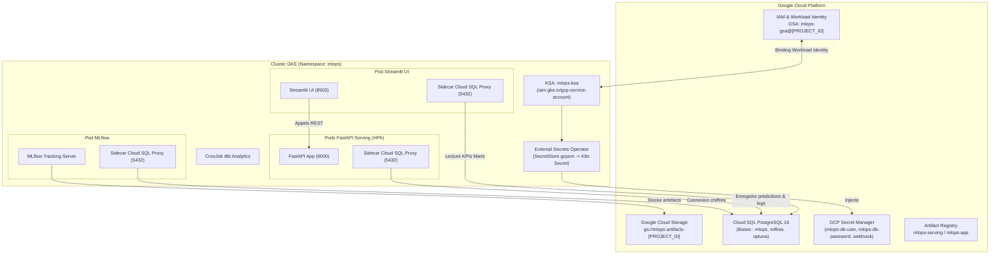

# Guide de Déploiement GCP & GKE : k8s_mlops_platform

Ce guide détaille le provisionnement et le déploiement de la plateforme MLOps sur **Google Cloud Platform (GCP)** avec **Google Kubernetes Engine (GKE)**.

Cette architecture s'appuie sur le pattern de référence validé dans [`caroheymes/mlflow-kubernetes`](https://github.com/caroheymes/mlflow-kubernetes) :
* **Base de données relationnelle infogérée** : Cloud SQL PostgreSQL via le sidecar Cloud SQL Auth Proxy (port 5432).
* **Stockage d'artefacts & modèles** : Google Cloud Storage (`gs://...`).
* **Gestion des secrets & conformité** : Google Cloud Secret Manager synchronisé via l'External Secrets Operator (ESO).
* **Sécurité Zero Trust** : Workload Identity (aucune clé de compte de service JSON stockée dans le cluster).

---

## 1. Architecture Cible GCP / GKE



---

## 2. Prérequis & Variables d'Environnement

Installez les outils CLI nécessaires :
* `gcloud` (Google Cloud SDK)
* `kubectl`
* `helm` (>= v3.8)
* `docker`

Définissez les variables de travail :

```bash
export PROJECT_ID="votre-projet-gcp"
export REGION="europe-west1"
export ZONE="europe-west1-b"
export CLUSTER_NAME="gke-mlops-platform"
export BUCKET_NAME="mlops-artifacts-${PROJECT_ID}"
export SQL_INSTANCE="mlops-db-instance"
export GSA_NAME="mlops-gsa"
export KSA_NAME="mlops-ksa"
export NAMESPACE="mlops"
export REPO_NAME="mlops-repo"

gcloud config set project ${PROJECT_ID}
gcloud config set compute/region ${REGION}
gcloud config set compute/zone ${ZONE}
```

Activez les APIs Google Cloud requises :

```bash
gcloud services enable \
    container.googleapis.com \
    sqladmin.googleapis.com \
    secretmanager.googleapis.com \
    artifactregistry.googleapis.com \
    storage.googleapis.com
```

---

## 3. Provisionnement de l'Infrastructure GCP

### 3.1. Google Artifact Registry

Créez le registre Docker pour héberger vos conteneurs :

```bash
gcloud artifacts repositories create ${REPO_NAME} \
    --repository-format=docker \
    --location=${REGION} \
    --description="Images Docker MLOps Platform"

# Authentification Docker
gcloud auth configure-docker ${REGION}-docker.pkg.dev
```

Construisez et poussez les images applicatives :

```bash
docker build -t ${REGION}-docker.pkg.dev/${PROJECT_ID}/${REPO_NAME}/mlops-serving:v1.0.0 -f docker/Dockerfile.serving .
docker push ${REGION}-docker.pkg.dev/${PROJECT_ID}/${REPO_NAME}/mlops-serving:v1.0.0

docker build -t ${REGION}-docker.pkg.dev/${PROJECT_ID}/${REPO_NAME}/mlops-app:v1.0.0 -f docker/Dockerfile.app .
docker push ${REGION}-docker.pkg.dev/${PROJECT_ID}/${REPO_NAME}/mlops-app:v1.0.0
```

### 3.2. Google Cloud Storage (Bucket Artefacts)

Créez le bucket de stockage pour les modèles MLflow :

```bash
gcloud storage buckets create gs://${BUCKET_NAME} \
    --location=${REGION} \
    --uniform-bucket-level-access
```

### 3.3. Base de Données Cloud SQL PostgreSQL

Créez une instance Cloud SQL PostgreSQL (version 16) :

```bash
gcloud sql instances create ${SQL_INSTANCE} \
    --database-version=POSTGRES_16 \
    --tier=db-custom-2-7680 \
    --region=${REGION} \
    --storage-size=20GB \
    --storage-auto-increase

# Définition du mot de passe administrateur
export DB_PASSWORD=$(openssl rand -base64 18)
gcloud sql users set-password postgres \
    --instance=${SQL_INSTANCE} \
    --password="${DB_PASSWORD}"

# Création des 3 bases de données isolées
gcloud sql databases create mlops --instance=${SQL_INSTANCE}
gcloud sql databases create mlflow --instance=${SQL_INSTANCE}
gcloud sql databases create optuna --instance=${SQL_INSTANCE}
```

Récupérez la chaîne de connexion de l'instance (`instanceConnectionName`) :

```bash
export INSTANCE_CONNECTION_NAME=$(gcloud sql instances describe ${SQL_INSTANCE} --format="value(connectionName)")
echo "Cloud SQL Connection Name: ${INSTANCE_CONNECTION_NAME}"
# Exemple de format : votre-projet-gcp:europe-west1:mlops-db-instance
```

### 3.4. GCP Secret Manager

Stockez vos identifiants dans Secret Manager :

```bash
echo -n "postgres" | gcloud secrets create mlops-db-user --data-file=-
echo -n "${DB_PASSWORD}" | gcloud secrets create mlops-db-password --data-file=-
echo -n "$(openssl rand -hex 24)" | gcloud secrets create mlops-webhook-token --data-file=-
```

### 3.5. Cluster GKE avec Workload Identity

Créez le cluster GKE en activant Workload Identity :

```bash
gcloud container clusters create ${CLUSTER_NAME} \
    --region=${REGION} \
    --num-nodes=2 \
    --machine-type=e2-standard-4 \
    --workload-pool=${PROJECT_ID}.svc.id.goog \
    --enable-autoscaling --min-nodes=2 --max-nodes=5

# Récupération du kubeconfig
gcloud container clusters get-credentials ${CLUSTER_NAME} --region=${REGION}
```

---

## 4. Configuration Sécurité & Workload Identity

### 4.1. Compte de Service Google (GSA) & Rôles IAM

```bash
# 1. Création du GSA
gcloud iam service-accounts create ${GSA_NAME} \
    --display-name="Service Account MLOps Platform"

export GSA_EMAIL="${GSA_NAME}@${PROJECT_ID}.iam.gserviceaccount.com"

# 2. Attribution des rôles
# - Connexion Cloud SQL via Proxy
gcloud projects add-iam-policy-binding ${PROJECT_ID} \
    --member="serviceAccount:${GSA_EMAIL}" \
    --role="roles/cloudsql.client"

# - Lecture/Écriture dans le bucket d'artefacts GCS
gcloud storage buckets add-iam-policy-binding gs://${BUCKET_NAME} \
    --member="serviceAccount:${GSA_EMAIL}" \
    --role="roles/storage.objectAdmin"

# - Accès aux secrets dans Secret Manager
gcloud projects add-iam-policy-binding ${PROJECT_ID} \
    --member="serviceAccount:${GSA_EMAIL}" \
    --role="roles/secretmanager.secretAccessor"
```

### 4.2. Binding Workload Identity (GSA ↔ KSA)

Liez le compte de service Kubernetes (`mlops-ksa` dans le namespace `mlops`) au GSA :

```bash
kubectl create namespace ${NAMESPACE}

gcloud iam service-accounts add-iam-policy-binding ${GSA_EMAIL} \
    --role="roles/iam.workloadIdentityUser" \
    --member="serviceAccount:${PROJECT_ID}.svc.id.goog[${NAMESPACE}/${KSA_NAME}]"
```

---

## 5. Déploiement des Opérateurs In-Cluster

### 5.1. External Secrets Operator (ESO)

Installez l'opérateur ESO via Helm :

```bash
helm repo add external-secrets https://charts.external-secrets.io
helm repo update

helm upgrade --install external-secrets \
    external-secrets/external-secrets \
    -n external-secrets \
    --create-namespace \
    --set installCRDs=true
```

---

## 6. Déploiement de la Plateforme avec Helm

Adaptez le fichier `helm/values-gcp.yaml` avec vos variables :

```bash
sed -i "s/PROJECT_ID/${PROJECT_ID}/g" helm/values-gcp.yaml
sed -i "s/PROJECT_ID:europe-west1:mlops-db/${INSTANCE_CONNECTION_NAME}/g" helm/values-gcp.yaml
```

Déployez la release Helm sur GKE :

```bash
helm upgrade --install k8s-mlops helm/ \
    -f helm/values-gcp.yaml \
    -n ${NAMESPACE}
```

Vérifiez le déploiement :

```bash
kubectl get pods -n ${NAMESPACE}
```

Chaque pod MLflow, Serving et Streamlit comporte 2 conteneurs (`mlflow` + `cloud-sql-proxy` ou `serving` + `cloud-sql-proxy`), illustrant le fonctionnement sidecar transparent.

---

## 7. Vérifications & Tests Opérationnels

### 7.1. Accès aux Portails via Port-Forward

```bash
# 1. Dashboard Streamlit (Monitoring & Dérives)
kubectl port-forward svc/k8s-mlops-streamlit 8503:8503 -n ${NAMESPACE}

# 2. Tracking MLflow
kubectl port-forward svc/k8s-mlops-mlflow 5000:5000 -n ${NAMESPACE}

# 3. API Serving FastAPI
kubectl port-forward svc/k8s-mlops-serving 8000:8000 -n ${NAMESPACE}
```

### 7.2. Test de l'Inférence & Enregistrement Cloud SQL

```bash
curl -X POST http://localhost:8000/predict \
  -H "Content-Type: application/json" \
  -d '{
    "features": {
      "MedInc": 3.87,
      "HouseAge": 28.0,
      "AveRooms": 5.4,
      "AveBedrms": 1.1,
      "Population": 1425.0,
      "AveOccup": 3.0,
      "Latitude": 37.88,
      "Longitude": -122.23
    }
  }'
```

---

## 8. Nettoyage des Ressources GCP

Pour supprimer les ressources et éviter les coûts résiduels :

```bash
helm uninstall k8s-mlops -n ${NAMESPACE}
gcloud container clusters delete ${CLUSTER_NAME} --region=${REGION} --quiet
gcloud sql instances delete ${SQL_INSTANCE} --quiet
gcloud storage rm -r gs://${BUCKET_NAME}
gcloud artifacts repositories delete ${REPO_NAME} --location=${REGION} --quiet
gcloud iam service-accounts delete ${GSA_EMAIL} --quiet
```
